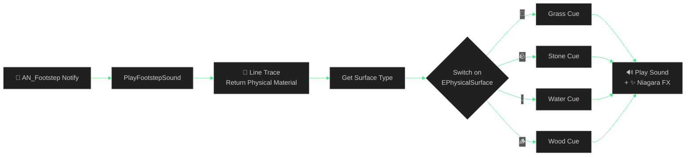

<div align="center">


<a href="https://git.io/typing-svg">
  
</a>

<br/><br/>


<br/>

### 🧭 &nbsp; [✨ Features](#-features) • [🕹️ Controls](#️-controls) • [🚀 Quick Start](#-quick-start) • [🧩 Blueprints](#-blueprint-studio) • [📊 Hardware Lab](#-hardware-scalability-lab) • [🗺️ Roadmap](#️-roadmap)

</div>

---

## 🏔️ About

**WILDLANDS: THE LOST KINGDOM** is a web app that acts as a production companion for building a realistic, cinematic, third-person open-world adventure in **Unreal Engine 5 using Blueprints only**.

This is a **treasure hunt** at heart: you play an explorer in a mysterious ancient kingdom reclaimed by nature, tracking down the Sunstone of Eldoria, hidden chests and the clues of a vanished civilization. The app gives you three tools in one:

<div align="center">

| 🎮 **Playable Prototype** | 🧩 **Blueprint Studio** | 📊 **Hardware Lab** |
|:---:|:---:|:---:|
| Third-person 3D explorer built with Three.js, with all five gameplay systems | UE5-style node graphs with one-click **Copy to UE5 (Ctrl+V)** | Frame-time, VRAM and FPS modeling for an RTX 3050 with 16 GB RAM |

</div>

> [!TIP]
> Created as a **beginner-friendly** path from an empty UE5 project to a polished playable prototype, then toward a 4K package.

---

## ✨ Features

### 🎮 Wildlands Engine Preview (Playable Prototype)

| | Feature | Details |
|:-:|---|---|
| 🧍 | **Third-person explorer** | Walk, Jog, Sprint (`Shift`), Crouch (`C`), Jump (`Space`) |
| 🖱️ | **Camera** | Mouse orbit, pointer-lock **Free Look**, terrain collision clamping |
| 🕹️ | **On-screen D-Pad** | Arrows, jump, sprint and camera buttons that light up with keyboard input |
| 🌄 | **Valley environment** | Procedural terrain, mountain ridges, river with water shader, wind-blown pine groves, ancient granite ruins |
| 🔊 | **Procedural audio** | Web Audio chimes, stone grinding, chest unlocks |
| 👣 | **Footstep system** | Heel-strike notifies, physical-material surfaces (grass, stone, water, wood), ±8% pitch jitter, dust and ripple particles |
| 🎛️ | **Director Dock** | Collapsible dock with graphic presets, time of day and sound toggles |

### 🧱 Gameplay Systems

| System | Badge | What it does |
|---|---|---|
| **A · Interaction** |  | `[E]` prompts for the **Sunstone of Eldoria**, **Weathered Explorer Chest** and **Temple Crypt Door** |
| **B · Objectives & Quests** |  | Live quest tracker with directives from Elder Thorne |
| **C · Inventory** |  | Backpack with weight-limit bar and a rotating 3D metallic PBR artifact inspector |
| **D · NPCs & Dialogue** |  | Elder Thorne's campfire, multi-choice dialogue, quest acceptance |
| **E · Exploration** |  | Landmark volumes with discovery banners and entries in the Explorer's Journal and Map |

**Landmarks to discover:** 🏛️ The Sunken Sun Temple · 🌫️ Valley of Whispers · 🔥 Thorne's Encampment

### 🧩 Blueprint Visual Scripting Studio

- 🔎 Zoomable and pannable UE5-style node canvas with a graphite grid
- 🌈 Typed pin colors:

       

- 📋 **Copy to UE5 (Ctrl+V)** exports Blueprint text you can paste into the UE5 Blueprint Editor
- 🧠 Node Inspector and step-by-step walkthroughs with common beginner pitfalls

### 📊 Hardware Scalability Lab

- ⏱️ Live GPU frame time (ms), VRAM use (of 8 GB) and projected FPS at 1080p, 1440p and 4K
- 🔍 TSR explainer: 70% screen percentage renders 1920×1080 internally at 1344×756
- 💻 One-click console commands: `stat unit`, `stat rhi`, `profilegpu`, Lumen and VSM bias
- 📝 Copyable `DefaultEngine.ini` and `DefaultScalability.ini` blocks
- 💾 Storage guide: active project on SSD, backups and archives on HDD

### 🗺️ Production Roadmap

- 8 phases from creating an empty project to final 4K package testing
- Interactive milestone checklist that saves your progress

---

## 🛠️ Tech Stack

<div align="center">


| Layer | Technology |
|---|---|
| UI framework | React 19 |
| Language | TypeScript |
| Build tool | Vite 8 with `@vitejs/plugin-react` |
| Styling | Tailwind CSS 4 via `@tailwindcss/vite` |
| 3D rendering | Three.js 0.186 with `@types/three` |
| Animation | Motion 12 |
| Icons | Lucide React |
| Server and AI | Express 4, `@google/genai`, `dotenv` |
| Tooling | `tsx`, `esbuild`, `autoprefixer` |
| Fonts | Cinzel, JetBrains Mono, Plus Jakarta Sans (Google Fonts) |
| Audio | Web Audio API (procedural) |

</div>

---

## 🕹️ Controls

<div align="center">

| Action | ⌨️ Keyboard | 📱 On-screen |
|---|---|---|
| Move forward / back | `W` `S` / `↑` `↓` | ▲ FWD / ▼ BACK |
| Strafe left / right | `A` `D` / `←` `→` | ◀ LEFT / ▶ RIGHT |
| Sprint | `Shift` | ⚡ Sprint |
| Jump | `Space` | ⏫ Jump |
| Crouch | `C` | |
| Orbit camera | Mouse, or `Q` / `E` | ↺ / ↻ |
| Interact | `E` | |
| Release cursor | `Esc` | 🎯 Free Look |

</div>

Movement is camera-relative: forward always moves away from the camera, and diagonals are normalized so speed stays constant.

---

## 🚀 Quick Start

> [!IMPORTANT]
> Requires **Node.js 20.19+ or 22.12+** (required by Vite 8), or Bun, since the repo includes `bun.lock`.

```bash
# 1. Clone
git clone https://github.com/vignesh90431-boop/Unreal-Game.git
cd Unreal-Game

# 2. Install
npm install          # or: bun install

# 3. Configure environment
cp .env.example .env
# then set GEMINI_API_KEY and APP_URL in .env

# 4. Start the dev server (http://localhost:3000)
npm run dev
```

### 📜 Scripts

| Command | Description |
|---|---|
| `npm run dev` | Start Vite on port 3000, host `0.0.0.0` |
| `npm run build` | Production build into `dist/` |
| `npm run preview` | Preview the production build |
| `npm run lint` | Type-check with `tsc --noEmit` |
| `npm run clean` | Remove `dist` and `server.js` |

### 🔑 Environment variables

| Variable | Purpose |
|---|---|
| `GEMINI_API_KEY` | Key for Gemini API calls (injected automatically inside Google AI Studio) |
| `APP_URL` | URL where the app is hosted |

> [!WARNING]
> Never commit your real `.env`. The included `.gitignore` already excludes `.env*` except `.env.example`.

---

## 🧩 Blueprint Studio

| Blueprint | Highlights |
|---|---|
| 🧍 `BP_WildlandsCharacter` | Enhanced Input (`IA_Move`, `IA_Look`, `IA_Sprint`), camera yaw isolation |
| 🤝 `BPI_Interactable` | Sphere trace by channel, interface call, interaction prompt |
| 📜 `BP_QuestManager` | `DT_Quests` data table lookup, objective event dispatchers |
| 🎒 `BP_InventoryComponent` | Item structs, encumbrance weight validation, array manipulation |
| 💬 `BP_NPC_Elder` | `SetViewTargetWithBlend` camera, dialogue widget creation |
| 📍 `BP_LandmarkVolume` | Overlap triggers, `DoOnce`, SaveGame integration |
| 👣 Footstep system | `AN_Footstep` notify, physical material trace, surface switch, sound and Niagara |



**Footstep setup in UE5:**

1. Name the surfaces in **Project Settings > Physics > Physical Surface**: `SurfaceType1` Grass, `SurfaceType2` Stone, `SurfaceType3` Water, `SurfaceType4` Wood.
2. Create `PM_Grass`, `PM_Stone`, `PM_Water`, `PM_Wood` physical materials and set each Surface Type.
3. Assign the physical material in your Landscape layer infos.
4. Create the `AN_Footstep` AnimNotify with a `FootSocketName` variable and call `PlayFootstepSound` on the character.
5. Add left and right notifies on the heel-strike frames of your Walk, Jog and Sprint animations.

> [!WARNING]
> Enable **`bReturnPhysicalMaterial`** on the Line Trace By Channel node, or `PhysMaterial` will always be `None`.

---

## 📊 Hardware Scalability Lab

-76B900?style=for-the-badge&logo=nvidia&logoColor=white)   

| Setting | Starting value |
|---|---|
| 📐 Resolution | 1920 × 1080 |
| 🔍 Upscaler | TSR at ~70% screen percentage |
| 🎯 FPS target | 30, then 60 later |
| 🖼️ Textures | Medium |
| 🌲 Foliage | Low to medium |
| 💡 Hardware ray tracing | Off initially |
| ☀️ Lumen | Tested at an affordable quality level |
| 🧱 Nanite | Selective |

```text
stat unit      # Frame / Game / Draw / GPU time
stat fps       # Frame rate
stat rhi       # Draw calls and GPU memory
stat gpu       # Per-pass GPU cost
profilegpu     # Single-frame GPU capture
```

> [!CAUTION]
> Native 4K at 60 FPS is **not** assumed on this hardware. The goal is a 3840×2160 *output* mode with upscaling and configurable graphics settings.

---

## 🗂️ Project Structure

<details>
<summary><b>📂 Click to expand</b></summary>

```text
Unreal-Game/
├── src/                    # React + Three.js application source
├── .env.example            # GEMINI_API_KEY, APP_URL
├── .gitignore
├── README.md
├── bun.lock
├── index.html              # Entry page (Cinzel, JetBrains Mono, Plus Jakarta Sans)
├── metadata.json           # AI Studio app metadata
├── package.json
├── tsconfig.json
└── vite.config.ts          # React + Tailwind plugins, "@" alias
```

</details>

---

## 🗺️ Roadmap

- [x] 🎮 3D prototype with third-person movement
- [x] 🧱 Systems A to E (interaction, quests, inventory, dialogue, exploration)
- [x] 🧩 Blueprint Studio with UE5 export
- [x] 📊 Hardware scalability lab
- [x] 👣 Animation-notify footstep system
- [x] 🖱️ Free-look cursor, camera-relative movement, on-screen D-Pad
- [ ] 🏊 Swimming, climbing and vaulting
- [ ] 🕳️ Caves, waterfalls and weather
- [ ] 🌗 Day and night cycle with atmospheric fog
- [ ] 🦌 Wildlife and ambient activity
- [ ] 🌍 World Partition, Data Layers and HLOD
- [ ] 📦 Final 4K package testing

---

## 🤝 Contributing

1. 🍴 Fork the repo
2. 🌿 `git checkout -b feature/amazing-idea`
3. 💾 `git commit -m "Add amazing idea"`
4. 🚀 Push and open a Pull Request

## ⚖️ Legal

All story, characters, locations and quests are **original**. Use only properly licensed assets in your Unreal project. Unreal Engine is a trademark of Epic Games, Inc.; this project is not affiliated with or endorsed by Epic Games or NVIDIA.

<div align="center">

<br/>


### ⭐ If this helps you build your game, give it a star! ⭐


</div>
