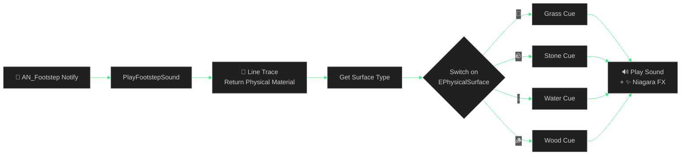

<div align="center">


<a href="https://git.io/typing-svg">
  
</a>

<br/><br/>


<br/>

### 🧭 &nbsp; [✨ Features](#-features) &nbsp;•&nbsp; [📸 Screenshots](#-screenshots) &nbsp;•&nbsp; [🕹️ Controls](#️-controls) &nbsp;•&nbsp; [🚀 Quick Start](#-quick-start) &nbsp;•&nbsp; [🧩 Blueprints](#-blueprint-studio) &nbsp;•&nbsp; [📊 Hardware Lab](#-hardware-scalability-lab) &nbsp;•&nbsp; [🗺️ Roadmap](#️-roadmap)


</div>

## 🏔️ &nbsp;About The Project

> 🌿 *"Nature has reclaimed the ancient kingdom. Only the explorer remains to uncover what was lost."*

**WILDLANDS: THE LOST KINGDOM** is a realistic, cinematic, third-person open-world adventure concept built around exploration, ancient mysteries and environmental storytelling.

This repo is your **all-in-one production companion** for building it in **Unreal Engine 5 with Blueprints only**.

<div align="center">

| 🎮 **PLAY** | 🧩 **BUILD** | 📊 **OPTIMIZE** |
|:---:|:---:|:---:|
| Live 3D third-person prototype with all core gameplay systems | Interactive UE5-style node graphs with **copy-paste** Blueprint export | RTX 3050 and 16 GB frame-time, VRAM and FPS simulator |
|  |  |  |

</div>

> [!TIP]
> 🎯 **Goal:** take a complete beginner from an empty UE5 project to a polished, playable prototype, then toward a 4K package.


## 📸 &nbsp;Screenshots

> [!NOTE]
> Add your captures to `docs/screenshots/` using the file names below.

<div align="center">

 

 

 

 

 

 

</div>


## ✨ &nbsp;Features

### 🎮 &nbsp;Interactive 3D Prototype

| | Feature | Details |
|:-:|---|---|
| 🧍 | **Third-person explorer** | Walk, Jog, Sprint, Crouch, Jump |
| 🖱️ | **Orbit camera** | Pointer-lock free look and terrain collision clamping |
| 🌄 | **Living valley** | Procedural terrain, mountain ridges, river with water shader, wind-blown pines, granite ruins |
| 🔊 | **Procedural audio** | Chimes, stone grinding, chest unlocks, surface footsteps |
| 👣 | **Footstep system** | Animation notifies, physical-material surfaces, ±8% pitch jitter, surface particles |
| 🕹️ | **On-screen D-Pad** | Arrows, jump, sprint and camera rotation, synced with the keyboard |

### 🧱 &nbsp;Gameplay Systems

| System | Badge | What it does |
|---|---|---|
| **A · Interaction** |  | Proximity `[E]` prompts, artifact pickup, doors and chests, audio feedback |
| **B · Objectives & Quests** |  | Live quest tracker, completion, success and failure messages |
| **C · Inventory** |  | Weight-limited backpack, quantities, descriptions, rotating 3D PBR inspector |
| **D · NPCs & Dialogue** |  | Elder Thorne's campfire, branching choices, quest accept and complete |
| **E · Exploration** |  | Landmark volumes, discovery banners, Explorer's Journal, map markers |

### 🧩 &nbsp;Blueprint Visual Scripting Studio

- 🔎 Zoomable and pannable node canvas with a graphite grid
- 🌈 Color-coded pins:

       

- 📋 **One-click "Copy to UE5 (Ctrl+V)"** exports real Blueprint text
- 🧠 Node Inspector plus beginner pitfall walkthroughs

### 📊 &nbsp;Hardware Scalability Lab

- ⏱️ Live GPU frame-time, VRAM (of 8 GB) and FPS projection at 1080p, 1440p and 4K
- 🔍 TSR guidance for 70% screen percentage
- 💻 One-click console commands and ready-to-copy `.ini` blocks
- 💾 SSD vs HDD storage guide


## 🛠️ &nbsp;Tech Stack

<div align="center">

**🖥️ Companion App**


**🎮 Game Engine Target**


| Layer | Technology | Badge |
|---|---|---|
| Engine | Unreal Engine 5 (Blueprints, Enhanced Input) |  |
| Rendering | Lumen, Nanite, Virtual Shadow Maps, TSR |  |
| World | Landscape, Foliage, World Partition, HLOD |  |
| UI | React and TypeScript |  |
| 3D Preview | Three.js and WebGL |  |
| Audio | Web Audio API |  |
| Build | Vite and npm |  |

</div>


## 🕹️ &nbsp;Controls

<div align="center">

| Action | ⌨️ Keyboard | 📱 On-screen |
|---|---|---|
| ➡️ Move forward / back | `W` `S` / `↑` `↓` | ▲ FWD / ▼ BACK |
| ↔️ Strafe | `A` `D` / `←` `→` | ◀ LEFT / ▶ RIGHT |
| ⚡ Sprint | `Shift` | ⚡ Sprint |
| ⏫ Jump | `Space` | ⏫ Jump |
| 🧎 Crouch | `C` | |
| 🎥 Rotate camera | Mouse or `Q` / `E` | ↺ / ↻ |
| 🤝 Interact | `E` | |
| 🔓 Release cursor | `Esc` | 🎯 Free Look |

</div>


## 🚀 &nbsp;Quick Start

> [!IMPORTANT]
> Requires **Node.js 18+** and **npm**.

```bash
# 1️⃣ Clone
git clone https://github.com/<your-username>/wildlands-the-lost-kingdom.git
cd wildlands-the-lost-kingdom

# 2️⃣ Install
npm install

# 3️⃣ Run
npm run dev

# 4️⃣ Build for production
npm run build
```

Open the local URL from your terminal, then click the viewport or **🎯 Free Look** to start exploring.


## 🧩 &nbsp;Blueprint Studio

| Blueprint | Highlights |
|---|---|
| 🧍 `BP_WildlandsCharacter` | Enhanced Input (`IA_Move`, `IA_Look`, `IA_Sprint`), camera yaw isolation |
| 🤝 `BPI_Interactable` | Sphere trace by channel, interface call, prompt |
| 📜 `BP_QuestManager` | `DT_Quests` lookup, event dispatchers |
| 🎒 `BP_InventoryComponent` | Item structs, weight validation, arrays |
| 💬 `BP_NPC_Elder` | `SetViewTargetWithBlend`, dialogue widget |
| 📍 `BP_LandmarkVolume` | Overlaps, `DoOnce`, SaveGame |
| 👣 Footstep system | `AN_Footstep` → trace → surface switch → sound and FX |



> [!WARNING]
> Footsteps return no surface unless **`bReturnPhysicalMaterial`** is enabled on the Line Trace node.


## 📊 &nbsp;Hardware Scalability Lab

-76B900?style=for-the-badge&logo=nvidia&logoColor=white)   

| Setting | Starting value |
|---|---|
| 📐 Resolution | 1920 × 1080 |
| 🔍 Upscaler | TSR at ~70% screen percentage |
| 🎯 FPS target | 30 → 60 later |
| 🖼️ Textures | Medium |
| 🌲 Foliage | Low to medium |
| 💡 Ray tracing | Off initially |
| ☀️ Lumen | Tested at affordable quality |
| 🧱 Nanite | Selective |

```text
stat unit      # Frame / Game / Draw / GPU time
stat fps       # Frame rate
stat rhi       # Draw calls and GPU memory
stat gpu       # Per-pass GPU cost
profilegpu     # Single-frame GPU capture
```

> [!CAUTION]
> Native 4K at 60 FPS is **not** assumed on this hardware. The target is a 3840×2160 *output* mode through upscaling and configurable settings.


## 🗂️ &nbsp;Project Structure

<details>
<summary><b>📂 Click to expand</b></summary>

```text
wildlands/
├── index.html
├── metadata.json
└── src/
    ├── App.tsx
    ├── types/game.ts
    ├── utils/audio.ts
    ├── data/
    │   ├── blueprintData.ts
    │   ├── hardwareData.ts
    │   └── roadmapData.ts
    └── components/
        ├── game3d/        # GameCanvas.tsx, textures.ts
        ├── blueprints/    # BlueprintEditor.tsx
        ├── hardware/      # HardwareProfiler.tsx
        ├── roadmap/       # ProductionRoadmap.tsx
        ├── inventory/     # ItemInspectorModal.tsx
        ├── dialogue/      # DialogueModal.tsx
        └── journal/       # JournalModal.tsx
```

</details>

## 🗺️ &nbsp;Roadmap

 &nbsp; 

- [x] 🎮 3D prototype with third-person movement
- [x] 🧱 Systems A–E (interaction, quests, inventory, dialogue, exploration)
- [x] 🧩 Blueprint Studio with UE5 export
- [x] 📊 Hardware scalability lab
- [x] 👣 Animation-notify footstep system
- [x] 🖱️ Free-look cursor, camera-relative movement, on-screen D-Pad
- [ ] 🏊 Swimming, climbing, vaulting
- [ ] 🕳️ Caves, waterfalls, weather
- [ ] 🌗 Day/night cycle and atmospheric fog
- [ ] 🦌 Wildlife and ambient activity
- [ ] 🌍 World Partition, Data Layers, HLOD
- [ ] 📦 Final 4K package testing

## 🤝 &nbsp;Contributing

1. 🍴 Fork the repo
2. 🌿 `git checkout -b feature/amazing-idea`
3. 💾 `git commit -m "Add amazing idea"`
4. 🚀 Push and open a Pull Request

## ⚖️ &nbsp;Legal

All story, characters, locations and quests are **original**. Use only properly licensed assets. Unreal Engine is a trademark of Epic Games, Inc.; this project is not affiliated with or endorsed by Epic Games or NVIDIA.

## 📄 &nbsp;License

Distributed under the **MIT License**. See `LICENSE`.

<div align="center">

<br/>


### ⭐ If this helps you build your game, give it a star! ⭐


</div>
